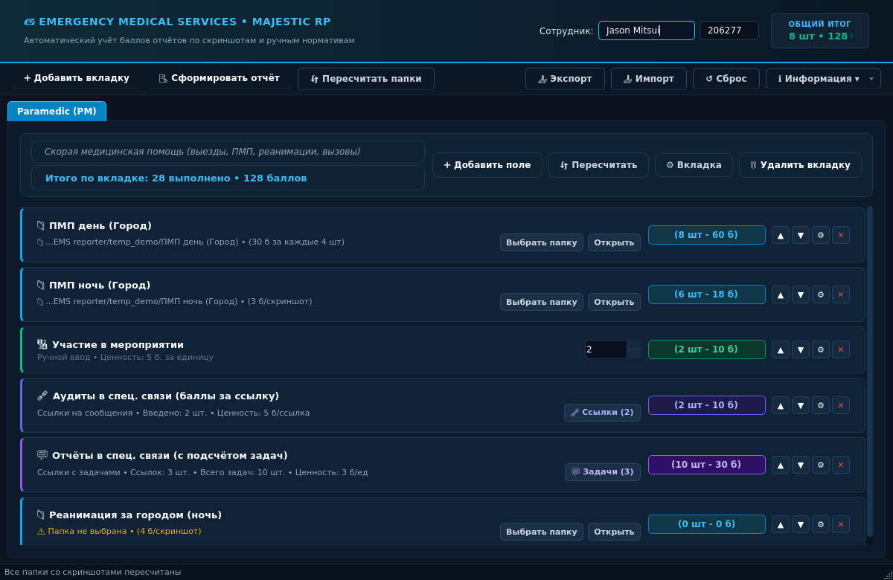
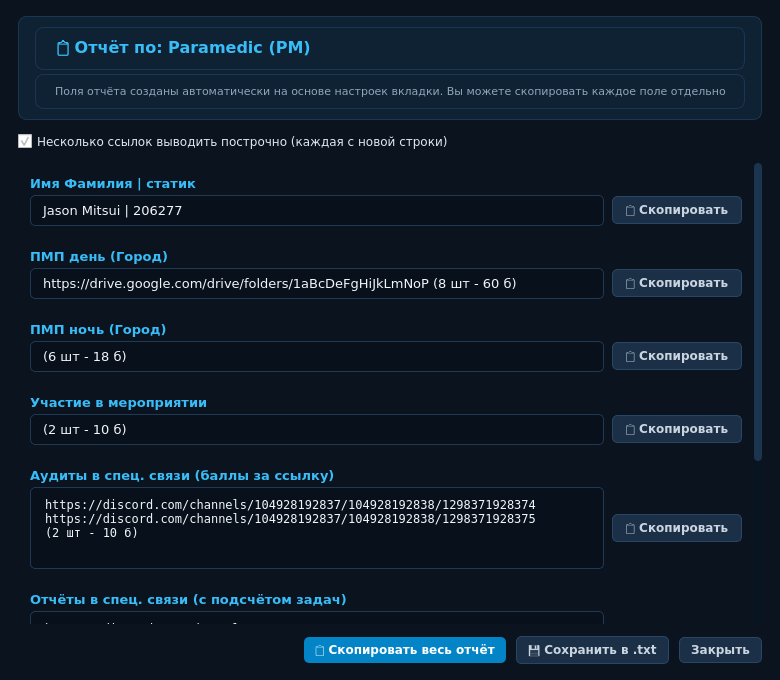
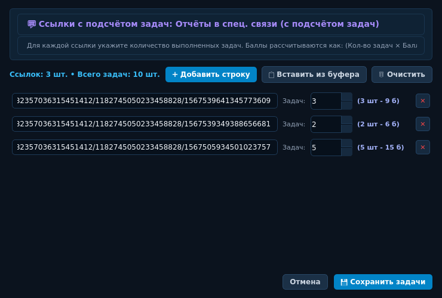
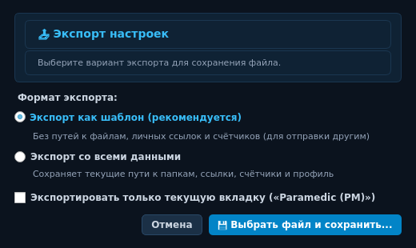
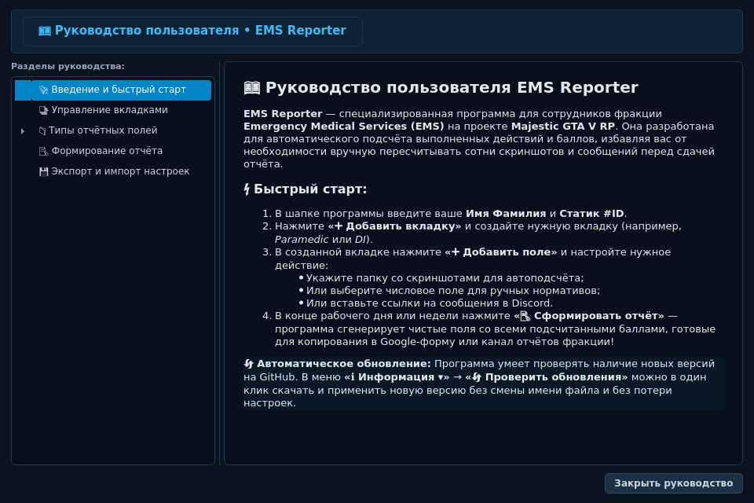
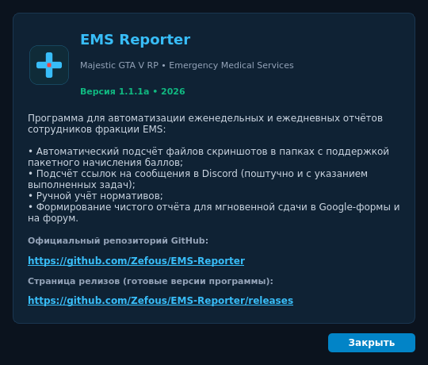
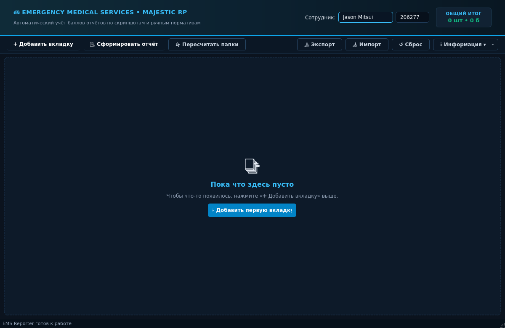

# 🚑 EMS Reporter — Majestic GTA V RP

Программа для автоматизации и подсчёта еженедельных и ежедневных отчётов для сотрудников фракции **Emergency Medical Services (EMS)** в RP-проекте **Majestic GTA V RP**.

Разработана специально для быстрой подготовки и сдачи отчётов в Google-формы, Discord или на Форум без ручного пересчёта скриншотов и сообщений.

[](https://github.com/Zefous/EMS-Reporter/releases)
[](https://www.python.org/)
[](LICENSE)

---

## 🌟 Основные возможности

### 1. 📑 Динамические вкладки
- **Чистый старт:** При первом запуске и сбросе программа открывается чистой, с удобной подсказкой в центре для создания первой вкладки.
- Любые вкладки можно создавать вручную, редактировать их название и описание, менять местами перетаскиванием мыши и удалять.
- **Общий итог в шапке:** Виджет «ОБЩИЙ ИТОГ» в правом верхнем углу рассчитывает баллы и выполненные действия **строго по открытой в данный момент вкладке**.

### 2. 🩺 Четыре типа отчётных полей
1. 📁 **Папка со скриншотами (автоподсчёт файлов):**
   - Указывается название действия, путь к папке со скриншотами и стоимость одного скриншота в баллах.
   - Программа автоматически считывает изображения (`.png`, `.jpg`, `.jpeg`, `.webp`, `.bmp`) в реальном времени.
   - **Пакетный расчёт скриншотов (с отбрасыванием остатка):** можно включить начисление баллов за комплект скриншотов (например, *за каждые 4 скриншота давать 30 баллов*). Если в папке 7 скриншотов, баллы начисляются только за 1 комплект (30 б), а остаток отбрасывается.
   - Кнопка **«Открыть»** мгновенно открывает папку со скриншотами в Проводнике Windows.
2. 🔢 **Числовое поле (ручной ввод):**
   - Для действий без скриншотов (участие в МП, счастливые вызовы, комплекты мед. справок).
   - Удобный счётчик прямо на карточке поля и живой пересчёт баллов.
3. 🔗 **Ссылки на сообщения (баллы за каждую ссылку):**
   - Классический список ссылок на сообщения в спец. связи Discord (проверки, аудиты, журналы).
   - Каждая непустая ссылка даёт фиксированное количество баллов.
4. 💬 **Ссылки с подсчётом задач (баллы за задачи):**
   - Продвинутый режим для спец. связи: для каждой ссылки указывается точное количество выполненных в ней задач.
   - В отчёте каждая ссылка отображается с индивидуальным количеством задач и баллов, а в конце подводится общий итог.

### 3. ☁️ Ссылка на облачное хранилище (Google Drive / Imgur)
- В настройках полей со скриншотами и ручным вводом можно указать ссылку на облачную папку или альбом.
- Ссылка не загромождает главный экран, а при формировании отчёта автоматически подставляется перед результатом.

### 4. 📝 Формирование и сдача отчёта
- Формируется **строго по текущей активной вкладке** с заголовком `Отчёт по: [Название вкладки]`.
- Каждое действие вынесено в отдельное поле с кнопкой **`📋 Скопировать`** напротив него для быстрой вставки в Google-форму.
- **Прочерк `-` для нулевых полей:** если действие не выполнялось (0 баллов), программа подставляет аккуратный прочерк `-` без кавычек.
- Кнопка **`📋 Скопировать весь отчёт`** копирует весь текст целиком.

### 5. 📤 Гибкий экспорт и умный импорт настроек
- **Экспорт:**
  - *Как шаблон (рекомендуется):* очищает все локальные пути к папкам, ссылки и счётчики. Экспортируются только названия вкладок и полей, их типы и стоимость баллов.
  - *Со всеми данными:* сохраняет полную копию конфигурации.
  - *Флажок «Только текущую вкладку»:* позволяет экспортировать либо одну конкретную вкладку, либо все вкладки сразу.
- **Импорт:**
  - *Добавить к существующим:* сохраняет текущие вкладки и добавляет новые вкладки из файла в конец списка.
  - *Заменить существующие:* заменяет все текущие вкладки структурой из файла.
- **Сброс:** кнопка `↺ Сброс` очищает все вкладки и поля, возвращая чистый стартовый экран.

### 6. ℹ Меню «Информация»
- **О программе:** версия приложения, описание и прямые ссылки на репозиторий GitHub и страницу релизов.
- **Руководство:** встроенный интерактивный справочник со структурированным деревом навигации и подробным описанием всех функций.

### 7. 🎨 Медицинский дизайн и плавный скролл
- Клиническая тёмно-бирюзовая палитра фракции EMS с компактным расположением элементов.
- Плавная прокрутка списков колесиком мыши (`SmoothScrollArea`).
- Текст на бейджах пересчёта баллов можно выделять мышью и копировать через `Ctrl+C`.
- Быстрое сохранение по клавише **Enter** в диалогах настроек.

---

## ⬇️ Скачать готовую программу (.EXE)

Самый простой способ — скачать готовый файл для Windows, не требующий установки Python:

👉 **[Скачать EMS_Reporter.exe со страницы релизов](https://github.com/Zefous/EMS-Reporter/releases)**

Просто скачайте файл и запустите его двойным кликом!

---

## 🚀 Запуск из исходного кода

### Для Windows:
Запустите файл **`run.bat`** двойным кликом — скрипт автоматически создаст локальное виртуальное окружение, установит зависимости и запустит приложение.

### Для Linux / macOS:
```bash
./run.sh
```
или:
```bash
python3 run.py
```

---

## 🛠 Самостоятельная сборка в .EXE (для разработчиков)

Если вы изменили исходный код и хотите скомпилировать обновлённый `.exe`:
1. Запустите файл **`build_exe.bat`** на Windows (или команду `python build.py`).
2. Скрипт проверит окружение, установит `PyInstaller` и упакует приложение в один файл.
3. Готовый файл появится в папке `dist\EMS_Reporter.exe`.

---

## 📖 Пример быстрого использования

1. Запустите программу.
2. В шапке введите ваше имя и статический ID (например, `Jason Mitsui` и `206277`).
3. Нажмите **`➕ Добавить вкладку`** и введите название (например, `Paramedic (PM)`).
4. Нажмите **`➕ Добавить поле`**:
   - Для скриншотов выберите *«Папка со скриншотами»*, укажите папку и стоимость за скриншот (или включите пакетный расчёт);
   - Для нормативов без скриншотов выберите *«Числовое поле»*;
   - Для ссылок на спец. связь выберите *«Ссылки на сообщения»* или *«Ссылки с подсчётом задач»*.
5. В конце смены нажмите **`📝 Сформировать отчёт`** — скопируйте нужные поля в форму!

---

## 📸 Скриншоты интерфейса

### Главное окно программы


### Формирование чистого отчёта для Google-форм


### Настройка ссылок Discord с указанием задач


### Гибкий экспорт (как шаблон или со всеми данными)


### Интерактивное руководство пользователя


### Окно «О программе»


### Начальный экран без вкладок

